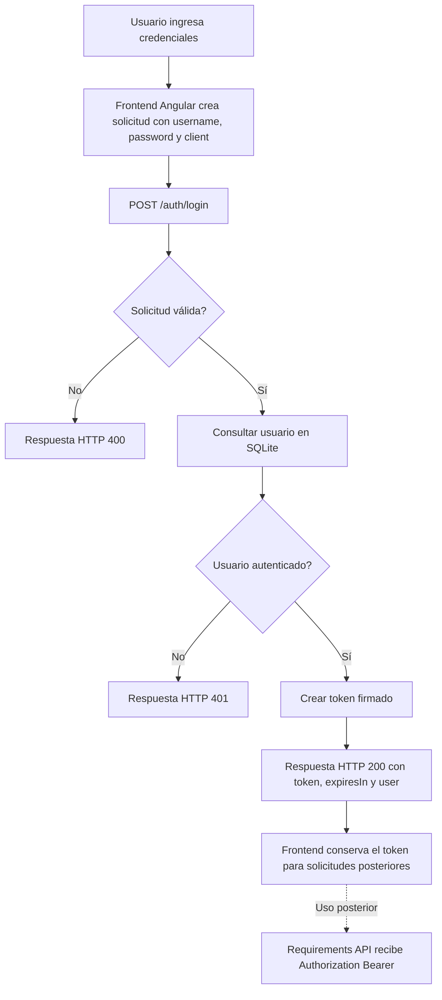
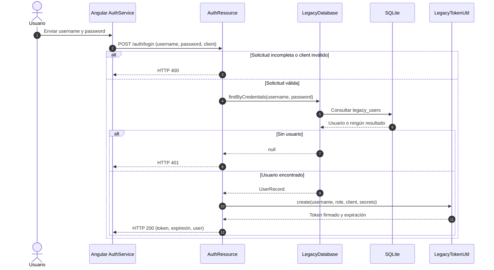

# Arquitectura — Workshop Auth Backend

Fecha de documentación: 2026-10-20

## Resumen

Servicio REST de laboratorio que valida credenciales de usuarios almacenados en SQLite y, cuando son válidas, emite un token firmado para que el cliente pueda consumir servicios del workshop. La implementación está concentrada en un recurso HTTP, una clase de acceso a datos y un utilitario de tokens.

El [README.md](README.md) clasifica explícitamente este proyecto como laboratorio intencionalmente vulnerable y prohíbe desplegarlo en Internet, CERT o producción. Esa limitación aplica a cualquier ejecución o despliegue del servicio.

## Descripción y alcance

- **Responsabilidad:** autenticación de usuarios del workshop mediante `POST /auth/login`.
- **Consumidor frontend:** la aplicación Angular envía `username`, `password` y `client`; recibe token, duración y datos básicos del usuario.
- **Consumidor posterior:** el frontend presenta el token como `Bearer` a la Requirements API para consultar tareas. El backend de autenticación no invoca directamente esa API.
- **Persistencia:** archivo SQLite local, con inicialización de tabla y datos de laboratorio al iniciar la aplicación.
- **Fuera de alcance:** gestión de usuarios, registro, recuperación de contraseña, autorización de rutas propias y llamadas salientes a otros servicios no están identificados en la implementación revisada.

## Stack tecnológico

| Área | Tecnología | Uso y evidencia |
| --- | --- | --- |
| Lenguaje y runtime | Java 21 | Compilación con `maven.compiler.release` y etapas Docker basadas en Eclipse Temurin 21. ([pom.xml](pom.xml), [Dockerfile](Dockerfile)) |
| Framework | Quarkus 3.27.4 | BOM y plugin de Quarkus declarados en Maven. ([pom.xml](pom.xml)) |
| API | Quarkus REST Jackson | Endpoints REST con JSON mediante `quarkus-rest-jackson`; inyección CDI con `quarkus-arc`. ([pom.xml](pom.xml), [AuthResource.java](src/main/java/com/bcp/workshop/auth/AuthResource.java)) |
| Health | SmallRye Health | Extensión declarada en Maven; `GET /q/health` está documentado en [README.md](README.md). No se encontró un recurso de salud propio. |
| Persistencia | SQLite JDBC 3.50.3.0 | Acceso JDBC directo; el valor por defecto es `jdbc:sqlite:./data/workshop.db` y puede sustituirse mediante `AUTH_DB_URL`. ([pom.xml](pom.xml), [LegacyDatabase.java](src/main/java/com/bcp/workshop/auth/LegacyDatabase.java)) |
| Tokens | HMAC-SHA256, formato JWT | El utilitario construye un token con encabezado `HS256`; el secreto se obtiene mediante la propiedad `auth.token.secret`. ([LegacyTokenUtil.java](src/main/java/com/bcp/workshop/auth/LegacyTokenUtil.java), [application.properties](src/main/resources/application.properties)) |
| Otras bibliotecas de ejecución | Apache Commons Text 1.9 | Declarada en Maven y usada para escapar el nombre visible en la respuesta. ([pom.xml](pom.xml), [AuthResource.java](src/main/java/com/bcp/workshop/auth/AuthResource.java)) |
| Build y pruebas | Maven, Quarkus JUnit 5, REST Assured, Surefire 3.5.4, JaCoCo 0.8.12 | Versiones y dependencias de prueba declaradas en Maven; la prueba de integración ejercita login y claims del token. ([pom.xml](pom.xml), [AuthResourceTest.java](src/test/java/com/bcp/workshop/auth/AuthResourceTest.java)) |
| Contenedor | Docker multi-stage | Empaqueta la aplicación con Maven/JDK 21 y la ejecuta sobre JRE 21; expone el puerto 8080. ([Dockerfile](Dockerfile)) |
| CI | GitHub Actions | El workflow configura Java 21 y ejecuta `mvn -B verify`. ([ci.yml](.github/workflows/ci.yml)) |

## Interfaces y configuración

| Interfaz/configuración | Comportamiento observado | Evidencia |
| --- | --- | --- |
| `POST /auth/login` | Recibe JSON con `username`, `password` y `client`. Devuelve `400` para una solicitud o campos inválidos, `401` si no se encuentra el usuario y `200` con `token`, `expiresIn` y `user` cuando autentica. La respuesta incluye además un campo `debug`. | `AuthResource.login` en [AuthResource.java](src/main/java/com/bcp/workshop/auth/AuthResource.java); prueba en [AuthResourceTest.java](src/test/java/com/bcp/workshop/auth/AuthResourceTest.java). |
| `GET /q/health` | Endpoint de health documentado por el proyecto; depende de la extensión SmallRye Health. | [README.md](README.md), dependencia en [pom.xml](pom.xml). |
| Puerto y host | Puerto 8080; host `127.0.0.1` por defecto y `0.0.0.0` bajo el perfil `prod`. | [application.properties](src/main/resources/application.properties). |
| Secreto de firma | `AUTH_TOKEN_SECRET` se mapea a `auth.token.secret`; la inicialización comprueba un mínimo de 32 bytes. El valor no se documenta ni se incluye aquí. | [application.properties](src/main/resources/application.properties), `validateSecret` en [LegacyTokenUtil.java](src/main/java/com/bcp/workshop/auth/LegacyTokenUtil.java). |
| Base SQLite | `AUTH_DB_URL` permite sustituir la URL; sin ella se usa el archivo local `./data/workshop.db`. | `DB_URL` en [LegacyDatabase.java](src/main/java/com/bcp/workshop/auth/LegacyDatabase.java). |

El token tiene una duración configurada de 3600 segundos y contiene los claims `iss`, `aud`, `sub`, `role`, `client`, `iat` y `exp`. El formato está firmado, no cifrado. ([LegacyTokenUtil.java](src/main/java/com/bcp/workshop/auth/LegacyTokenUtil.java))

## Flujos principales

### Login

**Flujo funcional:** el usuario entrega sus credenciales y el identificador del cliente al frontend; este llama al backend. El backend valida la solicitud, consulta SQLite y, si autentica al usuario, devuelve el token y los datos visibles. El frontend puede usar posteriormente el token al llamar a la Requirements API. Los errores de validación y autenticación se devuelven al frontend con sus respectivos estados HTTP.

**Flujo técnico:** el servicio recibe la llamada REST en `AuthResource`, delega la búsqueda a `LegacyDatabase` y crea el token mediante `LegacyTokenUtil`. La validación del secreto ocurre durante la inicialización del recurso.

### Inicialización de persistencia

Al inicializar `LegacyDatabase`, el servicio crea el directorio `data`, abre SQLite, crea la tabla `legacy_users` si no existe y agrega los usuarios de laboratorio si aún no están registrados. El flujo está implementado en `LegacyDatabase.initialize` ([LegacyDatabase.java](src/main/java/com/bcp/workshop/auth/LegacyDatabase.java)). No se incluye un diagrama separado porque es inicialización interna y no un recorrido funcional del consumidor.

## Dependencias e integraciones

| Sistema/componente | Tipo y dirección | Mecanismo y propósito | Evidencia / certeza |
| --- | --- | --- | --- |
| SQLite local | Persistencia local usada por el backend | JDBC; guarda usuarios del laboratorio en `./data/workshop.db` salvo que `AUTH_DB_URL` indique otra ubicación. | Verificado en `LegacyDatabase` ([LegacyDatabase.java](src/main/java/com/bcp/workshop/auth/LegacyDatabase.java)). |
| Workshop Login Frontend | Consumidor interno; frontend → backend y respuesta backend → frontend | HTTP JSON `POST /auth/login`; frontend configura `http://localhost:8080/auth/login` y envía `client=angular-workshop`. | Verificado en [environment.ts](../workshop-login-frontend/src/environments/environment.ts) y [auth.service.ts](../workshop-login-frontend/src/app/services/auth.service.ts), además de `AuthResource.login`. |
| Workshop Requirements API | Consumidor posterior del token; frontend → API | El frontend envía `Authorization: Bearer <token>` al endpoint de tareas. La API verifica firma HS256, `iss`, `aud` y expiración; utiliza el mismo secreto configurado por entorno. El backend de autenticación no llama directamente a esta API. | Verificado en [tasks.service.ts](../workshop-login-frontend/src/app/services/tasks.service.ts), [main.py](../workshop-requirements-api/app/main.py) y los claims de [LegacyTokenUtil.java](src/main/java/com/bcp/workshop/auth/LegacyTokenUtil.java). El README también describe esta relación. |
| GitHub Actions | Servicio de build, no dependencia de ejecución | Ejecuta `mvn -B verify` con Java 21 en push a `main` y pull requests. | Verificado en [ci.yml](.github/workflows/ci.yml). |

No se identificaron clientes HTTP salientes, colas, proveedores externos de identidad ni bases de datos remotas en el código del backend revisado. La integración con Requirements API es por emisión y consumo posterior del token, no por una llamada backend-a-backend.

## Límites, riesgos y vacíos

- El proyecto se declara laboratorio intencionalmente vulnerable; su documentación prohíbe explícitamente el despliegue en Internet o producción. ([README.md](README.md))
- La configuración actual de CORS usa una expresión que permite cualquier origen (`/.*/`). Revisar su alcance antes de cualquier exposición fuera del laboratorio. ([application.properties](src/main/resources/application.properties))
- El README menciona un secreto hardcodeado entre las deudas sembradas, mientras que el código revisado lee `AUTH_TOKEN_SECRET` desde configuración y valida su longitud. Este punto documental requiere confirmación; no se asume que el README describa exactamente el estado actual del código. ([README.md](README.md), [application.properties](src/main/resources/application.properties), [LegacyTokenUtil.java](src/main/java/com/bcp/workshop/auth/LegacyTokenUtil.java))
- [RETO.md](RETO.md) hace referencia a `docs/ENDPOINTS.md` como contrato, pero ese archivo no está presente en el repositorio revisado. El contrato observable se documenta aquí a partir del recurso y sus pruebas.
- `LegacyDatabase` captura excepciones de consulta y devuelve `null`; por ello un fallo de consulta puede terminar representado como `401`, indistinguible de credenciales no encontradas. La inicialización de la base también captura e imprime excepciones. ([LegacyDatabase.java](src/main/java/com/bcp/workshop/auth/LegacyDatabase.java))
- `AuthResource` convierte excepciones no manejadas en `500` y devuelve el mensaje y el nombre de clase de la excepción. Este comportamiento se describe como implementación actual, no como contrato recomendado. ([AuthResource.java](src/main/java/com/bcp/workshop/auth/AuthResource.java))
- No se verificó el despliegue en un entorno real ni la persistencia de SQLite en un contenedor; el Dockerfile no declara un volumen de datos.
- `HU-01.md` es una fuente de requisitos y evidencia esperada, no prueba por sí sola el comportamiento implementado. La implementación del token se contrastó con `LegacyTokenUtil` y `AuthResourceTest`. ([HU-01.md](HU-01.md), [AuthResourceTest.java](src/test/java/com/bcp/workshop/auth/AuthResourceTest.java))
